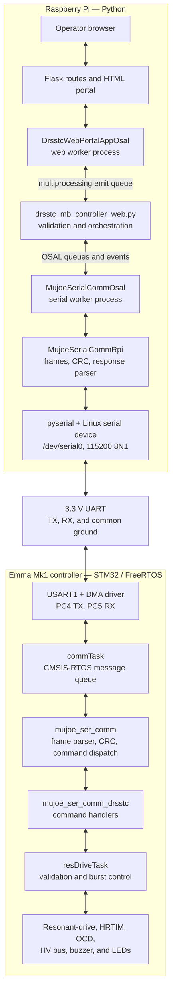
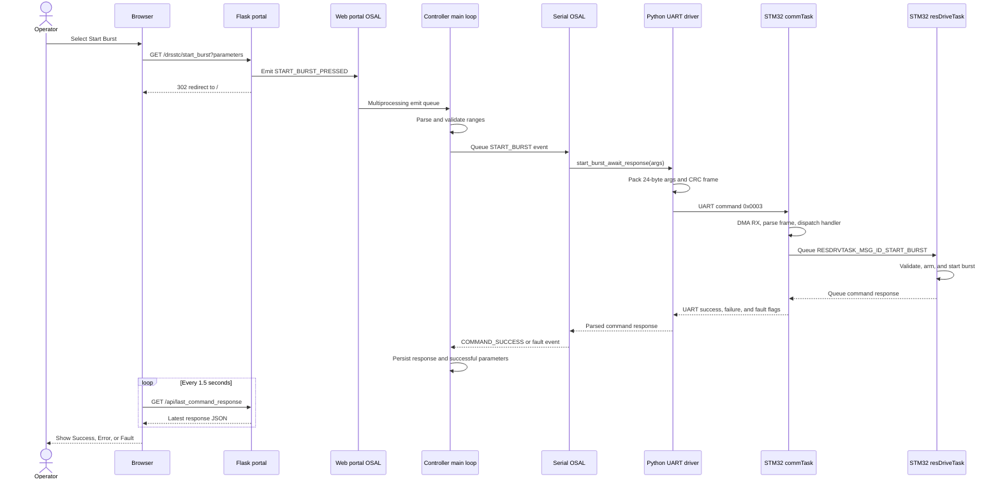

# Emma Mk1 DRSSTC Web Controller

Raspberry Pi software for controlling the <i>Emma Mk1 DRSSTC</i> over UART. The application provides a Flask web portal,
isolates the web and serial workers in OSAL processes, and exchanges framed,
CRC-protected commands with the <i>STM32G474RE</i> MCU.

<strong>[Emma Mk1 DRSSTC Full Documentation](https://www.mujoseph.com/projects/emma-mk1-drsstc)</strong>

## Features

- Configure over-current detection (OCD) threshold and comparator hysteresis.
- Command the high-voltage bus on or off.
- Start and stop bursts with configurable frequency, PRF, on-time, lead time,
  cycle count, and tracking limits.
- Download the STM32 resonant-period capture buffer as CSV.
- Display command success, error, and firmware fault responses.
- Hardware reset STM32 MCU during application startup through Raspberry Pi GPIO 25.

## Requirements

### Hardware

- Raspberry Pi running a current 64-bit Raspberry Pi OS release.
- <i>Emma Mk1 DRSSTC Motherboard PCB Rev A</i> with <i>DRSSTC_Driver</i> firmware.
- 3.3 V UART connection with a shared ground:
  - Raspberry Pi TX (GPIO 14) to STM32 RX (GPIO PC5).
  - Raspberry Pi RX (GPIO 15) to STM32 TX (GPIO PC4).
  - Raspberry Pi GPIO 25 to the controller `NRST` signal if startup hardware
    reset is enabled.

The software defaults to `/dev/serial0`, 115200 baud, 8 data bits, no parity,
and one stop bit. The STM32 implementation uses USART1 on PC4 (TX) and PC5
(RX).

### Software

- Python 3.11 is recommended because the pinned package snapshot was produced
  for the Raspberry Pi OS / Debian Bookworm generation.
- `python3-venv`, `python3-pip`, and Git.

## Raspberry Pi setup

Install the host tools:

```bash
sudo apt update
sudo apt install -y python3-venv python3-pip git
```

Enable the primary UART and prevent the Linux login console from using it:

```bash
sudo raspi-config
```

Under **Interface Options → Serial Port**, answer **No** to the login shell and
**Yes** to the serial hardware. The equivalent boot configuration includes:

```ini
enable_uart=1
dtoverlay=disable-bt
```

The repository's `rpi_config/config.txt` is a reference configuration. Review
and merge the relevant settings into `/boot/firmware/config.txt`; <b>do not
blindly replace an existing Pi configuration.</b>

After reboot, verify the UART interface:

```bash
ls -l /dev/serial0
```

## Python virtual environment

Two requirement files are provided:

- `requirements_drsstc.txt` contains the application's direct runtime
  dependencies and is the recommended deployment entry point.
- `requirements_full.txt` records the larger Raspberry Pi environment,
  including transitive versions and unrelated OS/desktop packages. It is useful
  as a version reference, but it is not a portable application dependency list.

### Recommended deployment environment

Create an isolated environment, install the direct dependencies, and use the
full snapshot only as constraints. This keeps the environment small while
preserving compatible versions of Flask's transitive dependencies:

```bash
python3 -m venv .venv
source .venv/bin/activate
python -m pip install --upgrade pip setuptools wheel
python -m pip install -r requirements_drsstc.txt -c requirements_full.txt
```

Verify the key imports:

```bash
python -c "import flask, numpy, serial, RPi.GPIO; print('Dependencies OK')"
```

Activate the environment in each new shell with:

```bash
source .venv/bin/activate
```

## Run the controller

From the repository root:

```bash
source .venv/bin/activate
python drsstc_mb_controller/drsstc_mb_controller_web.py
```

The default serial device is `/dev/serial0`. To select another device, pass it
as the first argument:

```bash
python drsstc_mb_controller/drsstc_mb_controller_web.py /dev/ttyUSB0
```

Startup creates three worker processes: the OSAL timer, serial communication,
and web portal. It also pulses GPIO 25 low to reset the STM32. When startup
succeeds, open:

```text
http://<raspberry-pi-ip>:5000/
```

The server binds to `0.0.0.0:5000`. It has no authentication or TLS and uses
Flask's built-in server, so expose it only on a trusted, firewalled control
network—not directly to the Internet.

Stop the controller with `Ctrl+C`. This terminates the worker processes.

## Web portal operation

1. Confirm the coil area is clear, the emergency stop works, and the HV bus is
   off before changing settings.
2. Set the **OCD Limit** and **Comparator hysteresis**, then select **Submit**.
3. Use **HV Bus Control** to request bus power. The toggle shows the last
   successful command; it is not live voltage feedback.
4. Configure **Burst Control**:
   - **Open loop frequency**: initial bridge frequency before feedback tracking.
   - **PRF period/frequency**: linked representations of the pulse repetition
     rate; only period is sent.
   - **PRF on-time**: active time in each PRF period.
   - **Lead time**: gate-drive timing adjustment.
   - **Burst duration / PRF cycles**: linked representations of burst length.
     Duration (ms) = PRF period (µs) × cycles / 1000; only cycles is sent.
     A finite burst must be at most 60,000 ms (1 minute). `0` cycles continues
     until **Stop Burst**.
   - **Tracked-frequency deviations**: permitted range around the open-loop
     frequency.
5. Select **Start Burst**. The controller validates the fields, sends the UART
   command, and reports the STM32 response. Use **Stop Burst** to halt an
   indefinite burst.
6. <b>Optional:</b> Under **Resonant Period Capture Dump**, choose a path on the Raspberry Pi,
   select **Start Dump**, and download the completed CSV from the portal. <strong>This should only be down when the Emma Mk1 is idle ( e.g., no on-going resonant burst ).</strong>

Input bounds and additional guidance are available from the help icons beside
portal controls. A command marked **Success** was accepted and completed by the
<i>DRSSTC_Driver</i> firmware.

## Architecture

The Raspberry Pi application and <i>DRSSTC_Driver</i> firmware mirror one another around the
UART protocol.



## Start Burst Command Sequence

The Start Burst form uses a normal HTTP GET followed by a redirect. Command
completion is asynchronous: the browser polls the response API while the OSAL
and UART workers wait for the STM32 result.


